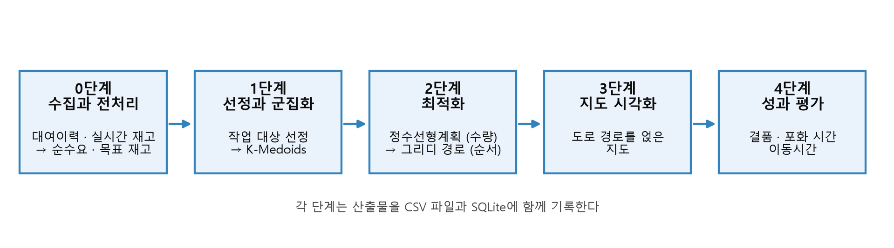
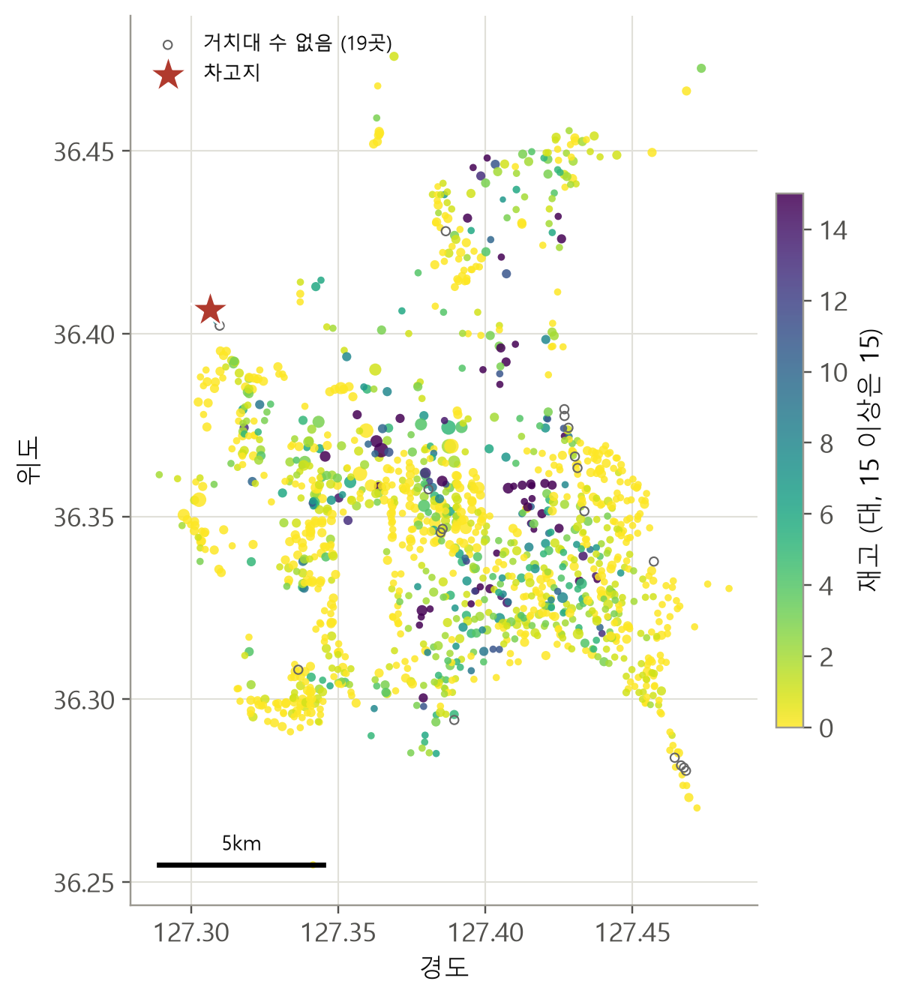
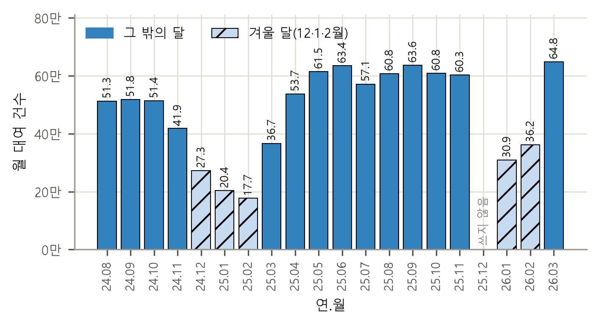
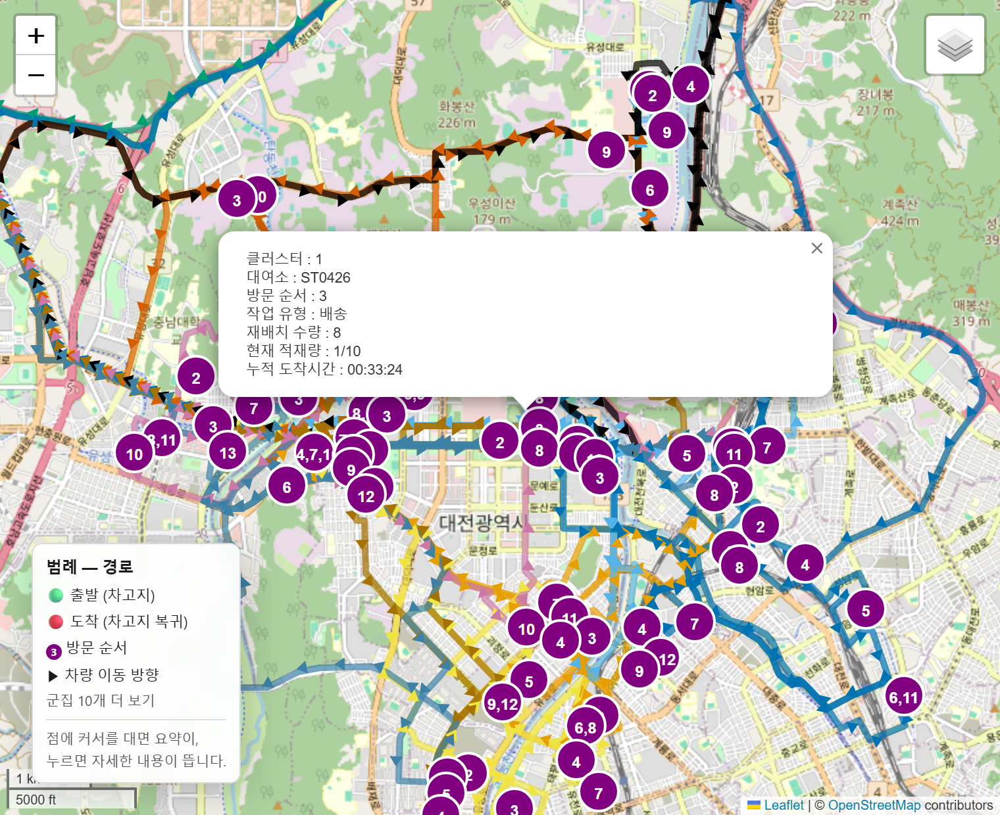
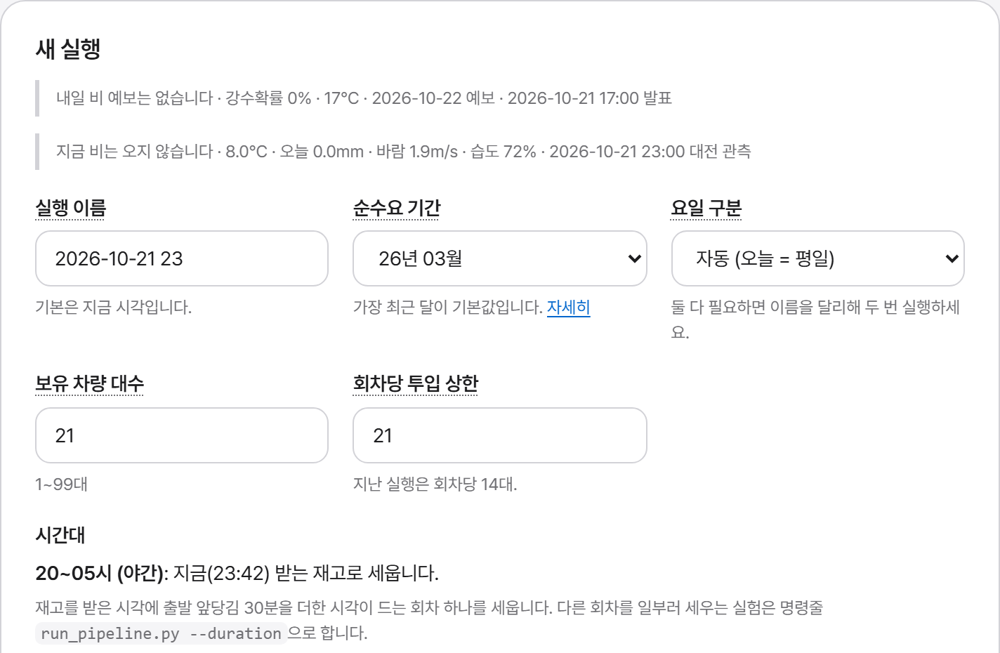
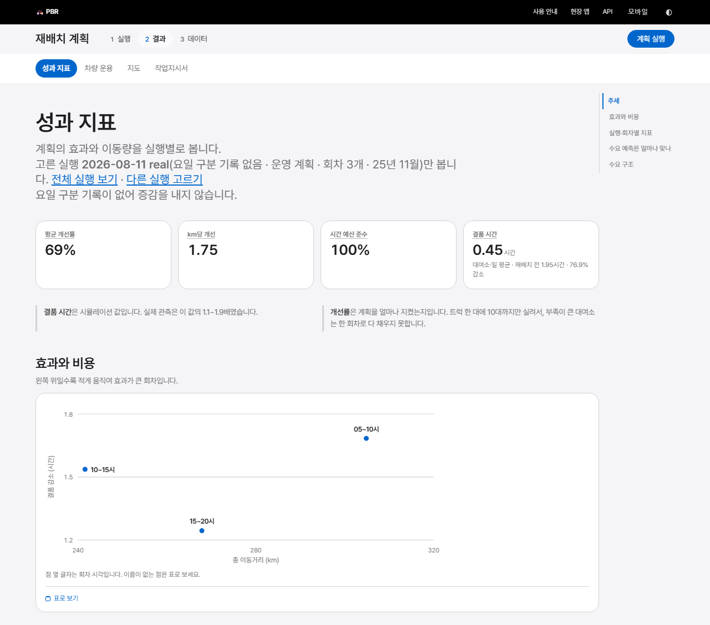
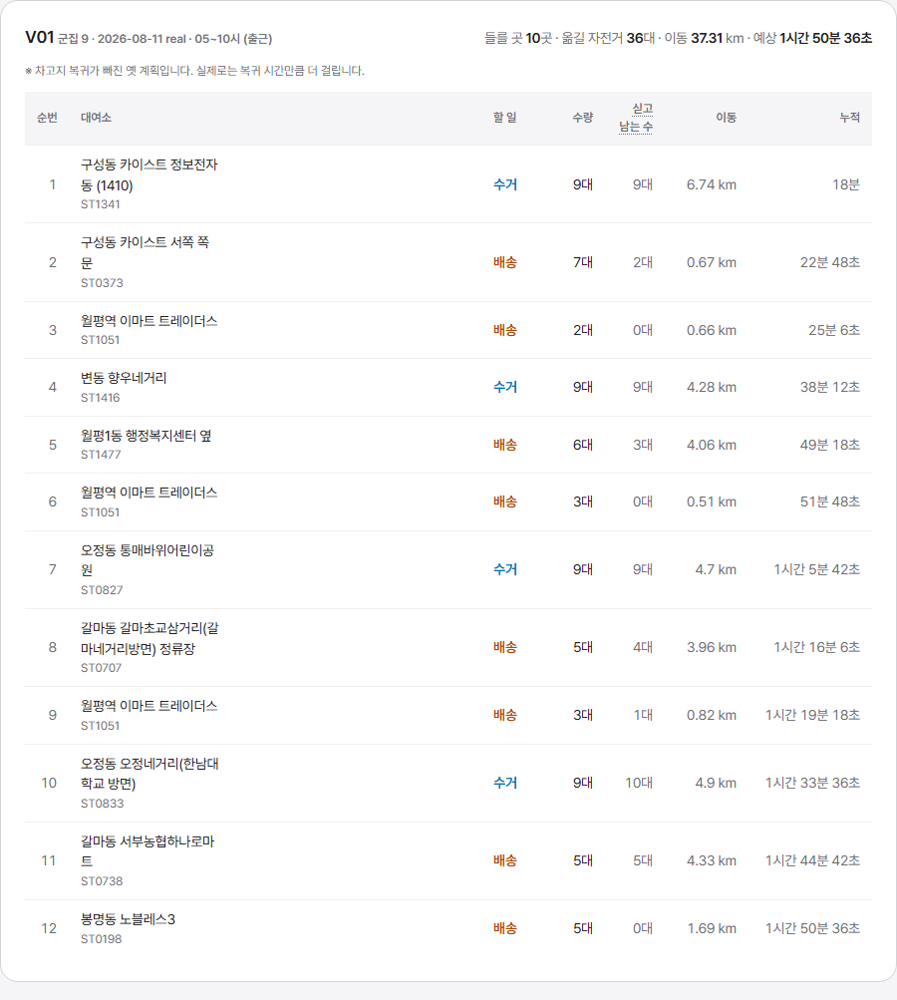
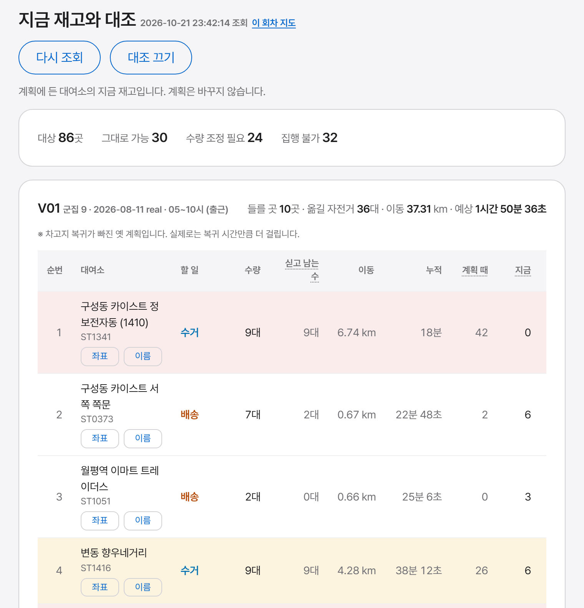

# 제4장 시스템 설계

이 장은 제3장의 모형을 실제로 계산하는 시스템의 구조를 설명한다. 4.1절에서 전체 흐름을,
4.2절에서 사용한 자료를, 4.3절에서 단계별 처리를 다룬다. 4.4절은 저장소, 4.5절은 차량 운용
규칙, 4.6절은 웹 대시보드, 4.7절은 재현성과 검증을 다룬다.

## 4.1 전체 구조

시스템은 원천 자료 수집부터 재배치 계획, 지도 시각화, 성과 평가까지를 하나의 흐름으로 잇는
파이프라인이다([그림 4-1]).

[그림 4-1] 시스템 파이프라인 구조

파이프라인은 다섯 단계이며(4.3절), 각 단계는 앞 단계의 산출물을 입력으로 받아 따로 실행할 수 있고
실행을 구분하는 식별자(실행 라벨)와 시간대를 공통 인자로 받는다. 구현 언어는 Python이며, 사용한
도구와 판은 <표 4-4>에 적는다.

## 4.2 자료

<표 4-1>에 시스템이 쓰는 자료를 정리하고, [그림 4-2]에 대여소의 분포를 보인다.

<표 4-1> 사용 자료

| 자료 | 출처 | 범위 | 용도 |
| --- | --- | --- | --- |
| 대여이력 | 공공데이터포털 타슈 대여이력(월별 원본) | 2024-08~2026-03(2025-12 제외), 19개월, 9,116,473건 | 순수요 산출 |
| 대여소 현황·재고 | 대전광역시 공영자전거 타슈 공개 API | 계획 시점 스냅샷(실험 기준 1,368곳) | 초기 재고, 거치대 수, 좌표 |
| 관측 재고 시계열 | 타슈 공개 API를 10분 간격으로 반복 조회 | 2026-08-25부터 | 결품 복원의 실측 대조 |
| 도로 이동시간 | 티맵모빌리티 TMAP 경로 안내 API | 고정 패널 100구간을 하루 네 번(400회), 2026-08-31부터 | 이동시간 식 (3.12)의 계수 추정 |
| 기상 | 기상청 종관기상관측(ASOS) 시간 자료, 단기예보 | 분석 기간 | 순수요와 기상의 관계 분석(계획에는 반영하지 않음) |

[그림 4-2] 대여소 분포와 차고지 위치 (2026년 8월 11일 스냅샷, 1,368곳). 점 크기는 거치대 수, 색은 재고이고,
거치대 수가 없는 19곳은 속이 빈 점으로 표시하였다.

대여이력은 공공데이터포털의 월별 원본을 그대로 적재하였다. 2025년 12월은 쓰지 않았다. 그 달의
이름으로 공개된 파일의 내용이 2025년 1월 자료와 같기 때문이다(대여 일시가 모두 2025년 1월이고
행 수도 같다). 그래서 19개월이 연속하지 않는다([그림 4-3]). 2025년 2월 26일 15시부터 3월 4일
11시까지는 기록이 끊겨 있어, 두 달은 날짜가 빠진 채로 쓴다. 겨울 달(2024년 12월, 2025년 1·2월,
2026년 1·2월)은 17만~36만 건으로 다른 달(37만~65만 건)보다 적지만, 위의 기간을 빼면 날짜가 빠진
날이 없고 일별 건수도 고르게 분포하여 결측이 아니라 겨울철 이용 감소로 판단하였다.

처음에는 월별 파일을 합친 병합 파일을 적재하였으나, 전처리가 그 파일을 덮어써 달마다 기록의
12~16%가 빠져 있었다(7.5절). 이 논문의 수치는 모두 월별 원본으로 다시 적재한 자료로 계산한 것이다.

[그림 4-3] 사용한 대여이력의 월별 건수 (19개월, 9,116,473건). 막대 위의 수는 만 건 단위이고, 빗금은
겨울 달(12~2월)이다. 2025년 12월은 쓰지 않았다.

실험에서 비교하는 모든 비용 수치는 같은 재고 스냅샷 하나(2026년 8월 11일 수집, 1,368곳. 이하 기준
스냅샷) 위에서 계산하였다. 재고는 실행 시각마다 달라지므로 스냅샷을 고정하지 않으면 방법의 차이와
재고의 차이를 가를 수 없기 때문이다.

## 4.3 단계별 처리

0단계(수집과 전처리)는 공개 API로 대여소별 현재 재고와 거치대 수, 좌표를 조회하고 월별 대여이력을
적재하여 대여소 정보를 통합한 뒤, 대여소별·시각별 순수요를 대여 건수와 반납 건수의 차이로 집계하고
식 (3.2)~(3.5)로 목표 재고와 재배치량을 계산한다. 1단계(선정과 군집화)는 식 (3.6)으로 수거·배송 후보를
고르고, 식 (3.7)로 군집 수를 정한 뒤 K-Medoids와 식 (3.8)의 조정으로 차량별 담당 구역을 만든다.
2단계(최적화)는 군집마다 식 (3.9)의 정수선형계획으로 옮길 대수를 정하고, 식 (3.10)의 그리디 규칙으로
방문 순서를 만든다.

운영 계획에서는 1단계의 수거 선정을 한 번 더 고친다(8.6절). 회차 날짜 전 최근 평일 10일의 관측 재고로
대여소가 회차 시작 뒤 5시간 안에 잃을 대수의 70% 분위를 기울기 부스팅 회귀 모형으로 학습하고, 계획 재고에서
이 예측과 여유 1대를 뺀 만큼을 빼도 되는 양으로 본다. 그 양이 큰 대여소부터 수거 총량을 채우므로 배송 대상과
수거 총량은 그대로이고 수거 대여소와 대수만 바뀐다. 휴일이거나 관측이 30분 넘게 끊겼거나 학습할 날이 5일보다
적으면 식 (3.6)의 선정을 그대로 쓰고, 어느 쪽으로 골랐는지를 계획과 함께 저장한다. 이 논문의 실험 계획은 모두
식 (3.6)의 선정으로 만든 것이다.

3단계(지도 시각화)는 경로와 수거·배송 지점, 군집을 지도에 표시한다. 지도에는 상용 경로 안내 API로
받은 실도로 경로를 그리지만, 계획 계산에는 식 (3.12)의 추정 이동시간을 쓴다([그림 4-4]). 4단계(성과
평가)는 식 (3.13)으로 재배치 전후의 결품 시간과 포화 시간을 계산하고, 군집별 이동거리와 소요시간을
성과 지표로 저장한다.

[그림 4-4] 경로 지도 출력의 예 (2026년 8월 11일 실행, 2025년 11월 통계, 05~10시). 선은 상용 경로 안내 API로 받은
실도로 경로이고 색은 차량(군집)이며, 원 안의 수는 방문 순서이다. 방문 표식에는 수량과 적재량, 누적 도착시간이
붙는다. 이 실행은 평일과 휴일 통계를 나누기 전의 산출물이다.
배경 지도: © OpenStreetMap 기여자.

## 4.4 데이터 저장소

시스템은 산출물을 CSV 파일과 SQLite 데이터베이스에 함께 기록한다. 데이터베이스 설계의 핵심은
한 행이 무엇에 속하는가라는 범위(scope)의 구분이다(<표 4-2>).

<표 4-2> 테이블의 범위 구분

| 범위 | 구분 키 | 해당 자료의 예 |
| --- | --- | --- |
| 실행 | 실행 라벨 | 계획 시점의 재고, 대여소 정보 |
| 실행과 회차 | 실행 라벨, 시간대 | 작업 대상, 물량 배분, 경로, 성과 지표 |
| 기간 | 자료 기간(월) | 순수요, 대여이력 |
| 관측 시각 | 관측 시각 | 관측 재고 시계열 |
| 전역 | 없음 | 차량 |

순수요를 실행이 아니라 기간의 범위에 둔 것이 중요한 판단이다. 순수요는 과거 대여이력에서만
계산되므로 언제 분석하든 같은 값이기 때문이다. 같은 실행을 다시 돌리면 해당 범위의 행을 먼저 지우고
다시 넣으므로 결과가 겹치지 않는다.

## 4.5 차량 운용

운영기관에 문의한 결과 재배치 차량은 21대이며 한 번에 모두 투입하지 않고 조를 나누어 운용한다
(운영기관 유선 문의, 2025년 9월 6일. 구두 답변이라는 한계는 8.4.1절). 시스템은 이 운용 방식 위에 본 연구의
회차 구조를 얹기 위해 차량 배정 계층을 따로 둔다. 회차당 투입 대수는 고정값이 아니라 식 (3.7)의 추정
작업량이 정하며, 기준 스냅샷의 세 회차에서 14~18대였다(수급 균형 조정 뒤에도 같았고, 옮길 물량이
없는 한쪽짜리 군집에는 차량이 나가지 않아 실제로 운행한 차량은 12~18대였다. 2025년 11월 평일 통계,
난수 씨앗 42). 따라서 보유 21대 안에서 교대 여유가 있다.

배정은 두 단계 규칙으로 이루어진다. 먼저 누적 작업시간이 적은 차량부터 그 회차에 필요한
대수만큼 뽑고, 뽑힌 차량 가운데 누적이 적은 차량일수록 작업량이 무거운 군집을 맡긴다. 별도의
순번표 없이 누적 기록만으로 교대가 이루어지므로, 차량이 정비로 빠지거나 회차 수가 바뀌어도
규칙이 그대로 성립한다.

이 규칙을 합성 부하의 결원 상황에서 시험하였다(군집당 60~100분, 회차마다 필요한 대수 12, 14, 16대,
1~6회차에 결원이 들고 7회차에 복구, 난수 씨앗 다섯 개의 평균). 배정은 가용 차량이 그 회차의 필요 대수
이상인 한 성립하여, 결원 5대까지는 모든 회차의 배정이 성립하였다. 다만 결원이 끝난 뒤에는 누적이 멈춰
있던 차량이 연이어 배정되어 차량별 누적 작업시간의 표준편차가 오히려 벌어졌고, 결원 중의 최댓값 아래로
돌아온 것은 결원 5대에서 복구 뒤 7회차째였다. 따라서 이 규칙은 단기 형평성을 보장하지 못한다.

## 4.6 웹 대시보드

파이프라인 실행과 결과 열람을 위해 서버 렌더링 방식의 웹 대시보드를 구현하였다. 주요 화면은
<표 4-3>과 같다.

<표 4-3> 웹 대시보드의 주요 화면

| 화면 | 기능 |
| --- | --- |
| 실행 | 기간, 시간대, 요일 구분, 차량 대수를 지정해 파이프라인을 백그라운드로 실행 |
| 성과 지표 | 실행별 지표와 같은 조건의 앞선 실행 대비 증감을 표와 그래프로 제시 |
| 차량 운용 | 차량별 누적 작업량, 형평성, 회차 배정 이력 |
| 작업지시서 | 차량별 방문 순서와 수량을 인쇄 가능한 형태로 제공 |
| 실시간 재고 대조 | 출발 직전에 계획 대상 대여소만 다시 조회하여 집행 가능 여부를 판정 |
| 지도·자료 | 단계별 지도와 산출 자료의 열람·내려받기 |

실행, 성과 지표, 작업지시서, 실시간 재고 대조 화면을 [그림 4-5]~[그림 4-8]에 보인다.

[그림 4-5] 웹 대시보드의 실행 화면. 기간, 시간대, 요일 구분, 차량 대수를 지정하며, 계획 시점의 날씨를 함께 보인다.

[그림 4-6] 성과 지표 화면 (2026년 8월 11일 실행). 지표 타일 아래의 그래프는 회차별 총 이동거리와 결품 감소를 한
평면에 놓아 효과와 비용을 함께 보인다. 이 실행은 평일과 휴일의 통계를 나누고 차고지 복귀 구간을 계산에 넣기 전의
산출물이어서 수치가 제6장과 다르다.

[그림 4-7] 작업지시서의 인쇄 형태 (2026년 8월 11일 실행, 05~10시, 차량 한 대). 차고지 복귀 구간이 없다는 안내는 이
실행이 복귀 구간을 계산에 넣기 전의 산출물이기 때문이다.

[그림 4-8] 실시간 재고 대조 화면 (2026년 8월 11일 실행의 05~10시 계획을 2026년 10월 13일 16시 50분의 재고와 대조).
회차 전체의 계획 대상 86곳 가운데 32곳은 그대로 집행할 수 있고, 33곳은 수량 조정이 필요하며, 21곳은 집행할 수
없다고 판정하였다. 표는 그 가운데 차량 한 대의 방문 12건이고, 음영 행은 수량을 조정해야 하거나 집행할 수 없는
곳이다.

설계에서 일관되게 지킨 원칙은 화면이 판정만 하고 계획을 자동으로 바꾸지 않는다는 것이다. 실시간
재고 대조가 계획과 다른 재고를 발견하거나, 비가 와서 실제 필요량이 줄어든다는 사실을 알리더라도
계획량은 바꾸지 않는다. 자동 보정을 넣으면 기사가 손에 든 작업지시서와 화면의 숫자가 어긋나기
때문이다.

## 4.7 재현성과 검증

구현과 실험은 두 대의 노트북에서 하였으며, 환경은 <표 4-4>와 같다. 두 환경의 소프트웨어 판은
같고 하드웨어와 운영체제 판만 다르다.

<표 4-4> 구현 및 실험 환경

| 구분 | 항목 | 환경 A | 환경 B |
| --- | --- | --- | --- |
| 하드웨어 | CPU | AMD Ryzen 5 7520U (4코어 8스레드, 2.8GHz) | Intel Core i5-1035G7 (4코어 8스레드, 1.2GHz) |
| | 메모리 | 16GB | 16GB |
| 소프트웨어 | 운영체제 | Windows 11 Pro 64비트 | Windows 11 Home 64비트 |
| | 언어 | Python 3.14.7 | 같음 |
| | 군집화 | kmedoids 0.5.5 (FasterPAM) | 같음 |
| | 정수선형계획 | PuLP 3.3.2, CBC 2.10.3 | 같음 |
| | 경로 비교 | OR-Tools 9.15 | 같음 |
| | 자료 처리 | pandas 3.0.5, NumPy 2.5.2, scikit-learn 1.9.0 | 같음 |
| | 저장소 | SQLite 3.50.4 | 같음 |
| | 지도·그림·화면 | Folium 0.20.0, matplotlib 3.11.1, FastAPI 0.141.1 | 같음 |
<!-- 환경 A는 2026-09-18, 환경 B는 2026-09-19에 읽은 값이다. 도로 이동시간 패널은 환경 B가 모았다(3.8절).
     실험별 실행 환경과 재실행 날짜는 2026-10-14 분량 줄이기에서 본문에서 뺐다(그 전 4.7절 둘째 문단). 3.1의 계산 시간은 원본 19개월로 바꾼 뒤 환경 B에서
     다른 계산을 돌리지 않은 채 다시 쟀다(EXPERIMENTS 42장. 그 전 값은 환경 A의 37장) -->

대여이력을 월별 원본으로 다시 적재한 뒤(4.2절), 제3장의 경로 비교와 단계별 계산 시간, 제5장의 파라미터
격자, 제6장의 대조군 비교, 제7장과 제8장의 구조 실험을 같은 코드로 다시 돌렸다. 계획 계산은 기간과 재고 스냅샷, 난수 씨앗을 인자로 받아 고정하므로 환경이 달라도 같은 결과를 내며, 제6장의
<표 6-2>, <표 6-3>, <표 6-4>는 두 환경에서 같은 조건으로 실행하여 같은 값을 얻었다. 다만 탐색
시간에 제한을 두는 3.7.2절의 경로 비교는 같은 제한 시간 안에서도 기계의 상태에 따라 찾은 해가 달라지므로,
그 값은 하한이다. 단계별 계산 시간(3.1절)은 환경 B에서 잰 값이다.

시스템은 자동화 테스트로 검증하며, 합성 자료로 파이프라인 전 구간을 실행하는 테스트가 있어 원천 자료
없이도 실행 가능성을 확인할 수 있다. 본 논문은 표마다 그 실험의 재고 스냅샷과 기간, 난수 씨앗을
함께 밝힌다. API 키와 원천 자료는 공개 저장소에 없으므로 재현하려면 각자 준비해야
하며, 실험별 재현 방법은 부록 A에 정리한다.
