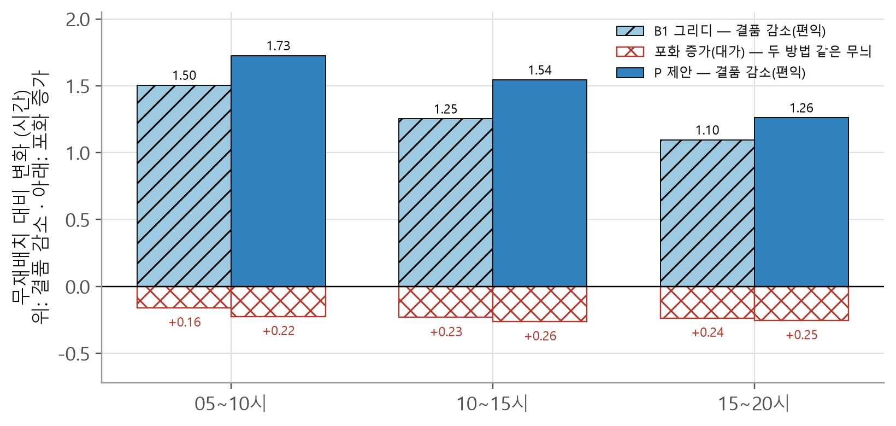
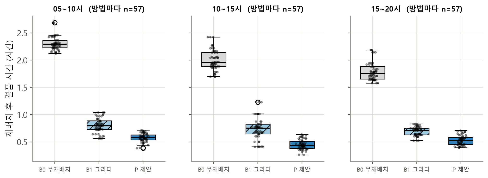

# 제6장 성능 평가

## 6.1 비교 설계

제5장까지의 실험은 제안 방법 안에서 어떤 값이 나은지를 물었다. 이 장은 다른 것을 묻는다.
제안 방법이 더 단순한 방법보다 나은가. 재배치 전후를 자기 자신과 비교하면 어떤 방법이든 좋아
보이므로, 같은 입력과 같은 평가 기준으로 다섯 가지 방법을 나란히 실행하였다(<표 6-1>).

<표 6-1> 비교한 다섯 가지 방법

| 기호 | 방법 | 제안 방법에서 무엇을 뺀 것인가 |
| --- | --- | --- |
| P | 제안 방법 | 없음. 군집화와 수급 균형 조정, 정수선형계획, 경로 휴리스틱을 모두 쓴다 |
| B0 | 무재배치 | 전부. 재배치를 하지 않은 채로 둔 경우이다 |
| B1 | 그리디 | 군집화와 정수선형계획. 차량이 차고지에서 가까운 작업지를 계속 고른다 |
| B2 | 평균 목표 재고 | 안전재고($z=0$) |
| B3 | 지리 균등 군집 | 군집 목적함수의 수급 불균형 항 |

다섯 가지에 운영기관의 현행 방식은 들어 있지 않다. 대전교통공사의 작업 이력이 없어 현행 방식을
나란히 돌릴 수 없으므로, 이 장의 기준선은 무재배치와 그리디 배분이다(8.3절).

판정 지표는 결품 시간이며(1.5절), 목표 재고를 분모로 삼는 개선률은 쓰지 않는다(3.9절). 평가는
계획량이 아니라 경로 계산이 실제로 옮긴 대수로 한다. 계획으로 재면 군집화와 정수선형계획을 건너뛴
B1도 같은 양을 옮긴 것으로 세어져 방법을 구분하지 못하기 때문이다(7.2절).

결품 시간과 포화 시간은 다섯 방법에 공통인 대여소 집합 위에서 평균한 값이다. 이 집합은 제안 방법의
작업 대상에 B2의 작업 대상을 합친 것으로 회차에 따라 76~115곳이며, 방법이 달라도 바뀌지 않는다.
B2를 돌리지 않는 19개월 반복(6.4절)에서는 제안 방법의 작업 대상이 그 집합이다. 재배치가 손대는
대여소에 한정한 평균이므로, 전체 대여소 1,368곳 위에서 잰 5.2.4절의 값과는 분모가 달라 서로 맞댈 수 없다.

모든 실행은 2026년 8월 11일 재고 스냅샷에 2025년 11월 평일 통계를 적용하고, 난수 씨앗 42로 한
결과이다. 이동시간은 식 (3.12)의 계수로 계산하였다. 실행 환경은 <표 4-4>의 환경 B이며, 다른 환경에서
다시 실행하여 같은 값을 얻은 것은 4.7절에 적었다. 다만 <표 6-3>의 수거 대수와 옮긴 대수의 구분, 6.4절의
옮긴 대수와 이동거리는 2026년 10월 8일 환경 A 재실행에서 얻은 값이다. 6.6절만은 조건이 다르며 그 절에서 밝힌다.

## 6.2 결품과 포화

<표 6-2> 재배치 뒤의 결품 시간과 포화 시간 (2025년 11월 평일 통계, 2026년 8월 11일 재고, 대여소·일 평균, 단위: 시간)

| 회차 | 방법 | 결품 | 무재배치 대비 | 포화 | 무재배치 대비 |
| --- | --- | ---: | ---: | ---: | ---: |
| 05~10시 | B0 무재배치 | 2.64 | 기준 | 1.28 | 기준 |
| | P 제안 | 1.35 | −1.29 | 1.44 | +0.16 |
| | B1 그리디 | 1.69 | −0.96 | 1.36 | +0.08 |
| | B2 평균 목표 재고 | 1.69 | −0.95 | 1.36 | +0.09 |
| | B3 지리 균등 군집 | 2.19 | −0.45 | 1.35 | +0.08 |
| 10~15시 | B0 무재배치 | 1.89 | 기준 | 1.04 | 기준 |
| | P 제안 | 0.36 | −1.53 | 1.41 | +0.37 |
| | B1 그리디 | 0.68 | −1.21 | 1.35 | +0.31 |
| | B2 평균 목표 재고 | 1.89 | 0.00 | 1.04 | 0.00 |
| | B3 지리 균등 군집 | 1.41 | −0.47 | 1.20 | +0.17 |
| 15~20시 | B0 무재배치 | 1.58 | 기준 | 0.99 | 기준 |
| | P 제안 | 0.57 | −1.01 | 1.27 | +0.28 |
| | B1 그리디 | 0.63 | −0.95 | 1.25 | +0.25 |
| | B2 평균 목표 재고 | 1.54 | −0.04 | 1.00 | +0.01 |
| | B3 지리 균등 군집 | 1.38 | −0.20 | 1.11 | +0.12 |

주: 무재배치 대비는 반올림하기 전 값으로 계산하였다. 표에 적힌 두 값을 빼면 0.01시간이 다를 수 있다.

제안 방법이 세 회차 모두에서 결품이 가장 낮다(<표 6-2>). 무재배치 대비 1.01~1.53시간을 줄였고, 그리디보다
05~10시에 0.33시간, 10~15시에 0.32시간 낮다. 15~20시에는 그 차가 0.06시간으로 작다. 수급 불균형 항을 뺀
B3는 옮기는 양 자체가 적어 감소폭이 재배치 전 결품의 3분의 1에 못 미친다. B2는 10~15시에 작업 대상을
한 곳만 만들어 한 대도 옮기지 못하였고, 15~20시에는 네 곳에서 9대를 옮기는 데 그쳤다. 안전재고를 빼면
낮 시간대에는 계획이 거의 서지 않는다는 뜻이다.

재배치에는 대가가 따른다. 같은 실행에서 포화 시간은 대상을 만든 모든 방법에서 늘어난다. 제안 방법은
0.16~0.37시간 늘었다. 같은 회차 안에서 B3는 제안 방법보다 적게 옮기고(회차당 61~130대 대 209~301대)
포화도 적게 늘었다(0.08~0.17시간). 결품만 보면 많이 옮길수록 좋다는 결론이 나오지만, 포화를 함께
보면 그 결론에 한계가 있다.

두 지표를 더하여 하나의 값으로 만들지 않았다. 같은 시간 단위이지만 무게가 다르기 때문이다. 재고가
0인 시간과 거치대가 가득 찬 시간은 이용자가 겪는 일이 다르고, 합산 지표를 만들려면 그 가중치를
먼저 정해야 한다. 본 연구는 두 값을 따로 보고한다.

[그림 6-1]은 이 관계를 열아홉 달로 넓혀 본 것이다(반복 설계는 6.4절). 위로 뻗은 막대가 무재배치 대비
결품 감소이고, 아래로 뻗은 막대가 같은 실행에서 늘어난 포화이다. 제안 방법과 그리디 모두 시간으로 견주면 결품 감소가
포화 증가보다 크고, 그 비는 05~10시에서 7.7~9.4배, 15~20시에서 4.6~5.0배이다. 두 시간의 무게가 같다는
뜻은 아니다.

[그림 6-1] 재배치의 편익과 대가 (19개월 × 씨앗 3개 평균, 평일, 2026년 8월 11일 스냅샷, 이동시간은
식 (3.12)의 계수). 위쪽 막대는 무재배치 대비 결품 감소이고 아래쪽 막대는 같은 실행의 포화 증가이다.

## 6.3 비용: 옮긴 대수, 이동거리, 시간

<표 6-3> 같은 실행의 비용 (이동시간은 식 (3.12)의 계수로 계산)

| 회차 | 방법 | 수거 대수 | 옮긴 대수 | 이동거리 (km) | 투입 차량 (대) | 가장 긴 운행 (분) | 예산을 넘긴 차량 (대) |
| --- | --- | ---: | ---: | ---: | ---: | ---: | ---: |
| 05~10시 | P 제안 | 301 | 301 | 469.2 | 18 | 125.4 | 1 |
| | B1 그리디 | 337 | 248 | 414.8 | 14 | 119.9 | 0 |
| | B2 평균 목표 재고 | 196 | 196 | 348.7 | 14 | 145.4 | 1 |
| | B3 지리 균등 군집 | 130 | 130 | 244.6 | 12 | 89.9 | 0 |
| 10~15시 | P 제안 | 209 | 209 | 391.6 | 13 | 141.1 | 4 |
| | B1 그리디 | 232 | 182 | 341.1 | 11 | 119.4 | 0 |
| | B2 평균 목표 재고 | 0 | 0 | 0.0 | 0 | 없음 | 0 |
| | B3 지리 균등 군집 | 72 | 72 | 162.3 | 7 | 131.4 | 1 |
| 15~20시 | P 제안 | 216 | 216 | 370.6 | 12 | 151.2 | 6 |
| | B1 그리디 | 256 | 213 | 460.8 | 14 | 120.0 | 0 |
| | B2 평균 목표 재고 | 9 | 9 | 28.9 | 1 | 89.7 | 0 |
| | B3 지리 균등 군집 | 61 | 61 | 117.0 | 5 | 120.3 | 1 |

주: 수거 대수는 대여소에서 거둔 대수이고, 옮긴 대수는 그 가운데 다른 대여소에 배송한 대수이다.
정수선형계획이 수거량과 배송량을 맞추는 방법(P, B2, B3)에서는 두 값이 같다.

제안 방법은 세 회차 모두에서 시간 예산 120분을 넘는다. 가장 긴 운행이 125.4~151.2분이고, 회차마다
1~6대가 예산을 넘는다. 예산을 한 번도 넘지 않은 것은 그리디뿐이다. 그리디가 예산을 넘지 않는 것은
계획이 가벼워서가 아니라 예산이 찰 때까지만 담고 멈추는 방식이기 때문이다. 그래서 두 방법의 예산 초과
건수를 나란히 놓고 우열을 말할 수 없다. 제안 방법의 결품은 예산을 넘긴 계획으로 잰 값이다. 예산을
제약으로 걸면 이 계획은 물량의 9.2%(726대 가운데 67대)를 옮기지 못하고, 결품은 회차마다 0.002~0.010시간
늘어난다(8.2절).

그리디가 예산 안에서 멈춘 대가는 옮긴 대수에 나타난다. 그리디는 세 회차에서 337, 232, 256대를 수거하였으나
배송한 것은 248, 182, 213대이고, 회차마다 43~89대를 배송하지 못한 채 차고지로 돌아왔다. 수거 대수로는 그리디가
제안 방법보다 많지만, 옮긴 대수로는 05~10시에 53대, 10~15시에 27대, 15~20시에 3대 적다. 배송하지 못하고 돌아온
자전거는 수거한 대여소의 재고만 줄이므로, 그리디의 포화가 제안 방법보다 낮게 나오는 데에는 이 몫이 섞여
있을 수 있다. 그 크기는 재지 않았다.

이 표의 시간은 이동시간 식을 교체하면서 드러난 값이다. 상수 속도를 가정하던 이전 계산에서는 같은
계획의 가장 긴 운행이 102.8~118.0분이었고 예산을 넘긴 차량이 없었다. 결품, 포화, 옮긴 대수,
이동거리는 소수점까지 같다. 계획이 나빠진 것이 아니라, 같은 계획을 실제 도로로 재자
시간이 드러난 것이다(3.8절).

## 6.4 19개월 반복과 통계적 유의성

한 달의 결과는 그 달의 수요에 기댄다. 그래서 자료가 있는 19개월에 난수 씨앗 셋을 곱하여 다시 재고,
같은 기간과 같은 씨앗끼리 짝지어 부호순위검정을 하였다(시간대별 $n=57$, <표 6-4>).

<표 6-4> 19개월 반복의 중앙값 차와 유의확률 (평일, 난수 씨앗 3개, 부호순위검정, 양수는 제안 방법이 더 낮다는 뜻)

| 회차 | 비교 | 결품 중앙값 차 (시간) | $p$ | 포화 중앙값 차 (시간) | $p$ |
| --- | --- | ---: | ---: | ---: | ---: |
| 05~10시 | P 대 B0 | +1.693 | $5.1 \times 10^{-11}$ | −0.207 | $5.1 \times 10^{-11}$ |
| | P 대 B1 | +0.211 | $5.4 \times 10^{-11}$ | −0.072 | $1.3 \times 10^{-10}$ |
| 10~15시 | P 대 B0 | +1.529 | $5.1 \times 10^{-11}$ | −0.275 | $5.4 \times 10^{-11}$ |
| | P 대 B1 | +0.305 | $5.1 \times 10^{-11}$ | −0.029 | $2.8 \times 10^{-7}$ |
| 15~20시 | P 대 B0 | +1.230 | $5.1 \times 10^{-11}$ | −0.270 | $5.1 \times 10^{-11}$ |
| | P 대 B1 | +0.158 | $1.3 \times 10^{-10}$ | −0.020 | $4.8 \times 10^{-5}$ |

결품에서는 세 회차 모두 제안 방법이 두 대조군보다 유의하게 낮다. 포화에서 음의 부호는 제안
방법의 포화가 더 길다는 뜻이며, 그리디와의 차이도 세 회차 모두 유의하였다(가장 큰 $p$가
$4.8 \times 10^{-5}$). 그러나 포화 차이의 크기는 0.020~0.072시간(1.2~4.3분)으로 같은 짝의 결품
이득(0.158~0.305시간, 9.5~18.3분)의 1/10~1/3이다. 짝이 57개이면 작은 차이도 유의해지므로, 포화에
대해서는 유의성이 아니라 크기로 말한다. 제안 방법은 그리디보다 반납을 조금 더 막는다.

옮긴 대수에서도 한 달 비교에서 본 것(<표 6-3>)이 열아홉 달에서 유지된다. 19개월 평균으로 그리디는 회차당
249대를 수거하지만 200대만 배송하고 50대를 배송하지 못한 채 돌아온다. 제안 방법은 220대를 수거하여 모두 배송한다. 옮긴
대수로는 그리디가 제안 방법보다 9% 적으며, 171개 조합 모두에서 그리디는 배송하지 못하고 돌아온 자전거가 있었고
164개 조합에서 제안 방법보다 적게 옮겼다(부호순위검정, 시간대별 $n=57$, 가장 큰 $p$가 $4.5 \times 10^{-10}$).
이동거리는 그리디 402km, 제안 방법 406km로 거의 같다. 회차별로는 제안 방법이 05~10시와 10~15시에서
평균 8~23km 더 다니고 15~20시에서는 21km 덜 다닌다. 제안 방법의 결품이 낮은 것은 적게 옮겨서도 많이
달려서도 아니고, 같은 거리를 달려 더 많은 자전거를 필요한 곳에 배송하였기 때문이다.

[그림 6-2]는 그 중앙값 뒤에 있는 분포이다. 상자는 사분위 범위이고, 겹쳐 찍은 점이 개별 실행 57개이다.
세 회차 모두에서 제안 방법의 상자가 두 대조군보다 아래에 있고 상자끼리 겹치지 않는다. 다만 수염은
겹치고, 같은 달과 같은 씨앗끼리 짝지으면 57개 가운데 05~10시에 1개, 15~20시에 3개에서 그리디가 제안
방법보다 결품이 낮았다.

[그림 6-2] 19개월 반복의 재배치 후 결품 시간 분포 (평일, 씨앗 3개, 시간대별 $n=57$). 상자는 사분위
범위, 수염은 1.5 사분위수 범위이며, 겹쳐 찍은 점이 개별 실행이다.

## 6.5 이동시간 가정에 따른 대조군의 변화

그리디 대조군은 차량마다 시간 예산이 찰 때까지 작업지를 담으므로, 이동시간 식을 바꾸면 계획 자체가
달라진다. 상수 속도를 가정한 이전 계산과 견주면, 05~10시에 수거 대수는 337대로 같은데 배송 대수가
268대에서 248대로 줄고 이동거리가 333.5km에서 414.8km로 늘었으며, 결품은 1.56시간에서 1.69시간으로
나빠졌다. 나머지 두 회차에서도 수거 대수는 같고 배송 대수만 줄었다. 결품 시간은 집행된 재배치량으로
재므로(3.9절), 이 변화는 그리디가 더 멀리 달리고도 덜 배송하였다는 뜻이다.

19개월 반복의 평균으로 100km당 결품 이득을 계산하면 채택한 식에서는 제안 방법 0.372시간, 그리디
0.319시간이고, 상수 속도를 가정하면 0.372시간 대 0.397시간으로 순서가 반대였다. 세 회차 모두 같은
방향이다. 제안 방법은 군집을 먼저 고정하므로 값이 한 자리도 바뀌지 않았고, 그리디만 13% 더
달리고도(354.7km에서 402.2km) 이득이 1.410시간에서 1.284시간으로 줄었다. 따라서 제안 방법의 우위를
더 멀리 다녀서 얻은 결과로 읽을 수는 없다. 다만 이 값은 열아홉 달을 평균한 것이며, 실행 하나하나의
이동거리와 결품 감소는 흔들림이 커서 두 방법이 넓게 겹친다.

이동시간 식을 바꾸자 19개월 반복의 결품 중앙값 차는 시간대에 따라 0.084~0.110시간에서 0.158~0.305시간으로 벌어졌다.
제안 방법이 좋아진 것이 아니라 대조군이 실제 이동시간에서 나빠진 것이며, 그 대신 제안 방법은 예산을
넘긴다. 어느 쪽이 나은지는 예산 초과를 어떻게 다룰지에 달렸으며(8.2절), 이 판단도 이동시간 식에 기댄다.

## 6.6 관측으로 본 작업 대상

6.2절부터 6.5절까지의 결품 시간은 재고 스냅샷 한 장에 순수요를 더해 복원한 궤적 위에서 잰 값이다. 복원으로는 계획이
고른 대여소가 그 뒤에 실제로 비었는지를 보일 수 없다. 그래서 2026년 8월 25일부터 10월 8일까지 10분 간격으로 모은 관측
재고로 같은 방법들을 다시 견주었다. 평일 75회차의 회차 시작 시각마다 그 시각의 관측 재고와 2026년 3월 평일 통계로 각
방법의 계획을 세우고, 차량이 실제로 수거하고 배송한 대여소를 그 뒤 30분부터 5시간까지의 관측 재고로 채점하였다. 여기에
지금 재고만 보는 규칙을 하나 더하였다. 제안 방법과 같은 수의 대여소를 재고가 가장 적은 곳부터 골라 같은 총량을 배송하고,
재고가 가장 많은 곳들에서 같은 총량을 고르게 수거하는 규칙이다. 판정 기준은 결과를 보기 전에 정해 두었다.

이 계획들은 집행되지 않았으므로 관측 재고는 재배치가 없었던 상태이다. 따라서 이 절이 재는 것은 결품이 얼마나 줄었는가가
아니라 계획의 진단이 맞았는가이다. 배송 적중은 계획 시각에 재고가 남아 있던 배송 대상 대여소가 창 안에서 재고 0에 닿은
비율이고, 수거 무해는 관측 재고에서 수거량을 빼도 창 안에서 재고가 한 번도 0이 되지 않았을 비율이다.

<표 6-5> 관측 재고로 채점한 작업 대상 (평일, 2026년 8월 25일~10월 8일)

| 지평 | 방법 | 배송 적중 | 수거 무해 | 회차당 배송 적중 대여소 (곳) |
| --- | --- | ---: | ---: | ---: |
| 3시간 | P 제안 | 77.5% | 75.1% | 11.8 |
| | B1 그리디 | 76.9% | 75.2% | 9.9 |
| | B2 평균 목표 재고 | 84.8% | 77.8% | 2.5 |
| | B3 지리 균등 군집 | 73.5% | 65.9% | 6.0 |
| | 지금 재고 규칙 | 67.6% | 77.6% | 10.3 |
| | 무작위 | 47.1% | 해당 없음 | 해당 없음 |
| 5시간 | P 제안 | 88.8% | 59.2% | 11.5 |
| | B1 그리디 | 88.1% | 58.9% | 9.6 |
| | B2 평균 목표 재고 | 95.7% | 44.7% | 2.3 |
| | B3 지리 균등 군집 | 86.0% | 49.7% | 5.9 |
| | 지금 재고 규칙 | 75.9% | 61.1% | 9.8 |
| | 무작위 | 58.7% | 해당 없음 | 해당 없음 |

주: 배송 적중의 분모는 계획 시각에 재고가 남아 있던 배송 대상 대여소이고, 무작위는 관측된 모든 대여소에서의 비율이다.
회차당 값은 75회차로 나눈 값이며, 창이 관측되어 채점에 든 회차는 3시간 59회차, 5시간 52회차이다.

제안 방법이 배송하라고 한 대여소 가운데 재고가 남아 있던 곳의 77.5%가 3시간 안에, 88.8%가 5시간 안에 실제로
비었다(<표 6-5>). 무작위로 고르면 47.1%와 58.7%이고, 지금 재고가 가장 적은 곳을 고르는 규칙은 67.6%와 75.9%이다.
회차별로 보아도 제안 방법이 3시간에서 42회차, 5시간에서 35회차 앞섰고 뒤진 회차는 8회차와 3회차였다(부호검정,
$p<0.0001$). 30분과 1시간 안에서는 규칙과 차이가 없었다(1시간 42.4% 대 40.6%). 계획이 앞서는 까닭은 지금 재고가
아니라 몇 시간 뒤의 수요를 본다는 데 있다.

수거는 그렇지 않았다. 수거 대상 대여소의 91.5%는 계획 시각에 이미 거치대만큼 차 있어 장소는 맞았으나, 계획한 양을
뺐다면 3시간 안에 25%, 5시간 안에 41%가 한 번은 재고가 0이 되었을 것이다. 같은 총량을 고르게 빼는 규칙보다 2%p 남짓
나쁘다. 틀린 것은 빼는 양이다.

대조군 사이의 순서는 6.2절과 다르다. 그리디는 배송 적중과 수거 무해 모두 제안 방법과 구별되지 않았다(회차 재표집
98.3% 구간이 두 지표와 두 지평의 네 차이 모두에서 0을 포함). 두 방법은 같은 작업 후보에서 출발하므로,
군집화와 정수선형계획의 몫은 어느 대여소를 고르느냐가 아니라 같은 후보 가운데 얼마를 옮겨 끝내느냐에
있다(6.3절, 6.4절). 수급 불균형 항을 뺀 B3는 두 지표 모두 제안 방법보다 낮았다(배송 2.8~3.9%p, 수거 9.2~9.5%p). 평균 목표 재고 B2는 배송 적중 비율이 가장 높지만
회차당 맞힌 대여소가 2.3~2.5곳으로 제안 방법의 5분의 1이고, 배송이 하나도 없는 회차가 29%였다. 대상을 적게 고르면
비율은 쉽게 오르므로 이것은 정밀도와 범위를 맞바꾼 결과로 읽는다.

<표 6-5>의 값은 차량이 실제로 가는 대여소를 채점한 것이다. 계획표가 진단한 대여소 전체를 채점하면 제안 방법의
배송 적중이 72%와 84%로 낮아지고, 지금 재고 규칙에 대한 3시간 안의 우위도 10~15시와 15~20시에서는 거의
없었다. 이 결과는 한 수집 환경에서 7주 동안 모은 관측이고, 통계는 2026년 3월, 관측은 8~10월이다. 관측 재고에는
운영기관이 실제로 수행한 재배치가 섞여 있어 배송 적중을 낮추는 쪽으로 작용한다(8.3절).

## 6.7 소결

연구 질문 1과 2에 대한 답은 다음과 같다. 제안 방법은 19개월 반복의 중앙값 차로 무재배치보다 결품을 1.23~1.69시간,
그리디보다 0.16~0.31시간 줄인다. 열아홉 달과 세 씨앗을 반복해도 방향이 바뀌지 않았고, 시간대별로도 유의하다.
그리디와는 이동거리가 거의 같고 배송한 양이 다르며, 관측 재고로 채점한 대상 선정에서는 두 방법이
구별되지 않았다. 그 관측 채점에서 제안 방법이 배송하라고 한 대여소는 몇 시간 뒤 실제로 비었고(3시간
77.5%, 5시간 88.8%), 지금 재고만 보는 규칙보다 10%p 남짓 높았다. 수거 쪽은 그 규칙보다 2%p 남짓 나빴다.

연구 질문 3의 답인 대가는 둘이다. 포화가 늘고, 시간 예산을 넘는다. 포화 증가는 그리디 대비 결품 이득의
1/10~1/3로 작다. 예산 초과는 작지 않아 회차마다 1~6대가 120분을 넘으며, 이는 제안 방법이 예산을 사후
점검으로만 다루기 때문에 생기는 결과이다. 예산을 제약으로 걸면 물량의 9.2%를 옮기지 못한다(8.2절).

이 장의 절댓값은 재고 스냅샷에 딸려 있어 다른 시점이나 다른 연구의 값과 직접 견줄 수 없다(8.3절).
무엇을 고칠 수 있고 무엇이 선택인지는 제8장에서 다룬다.
